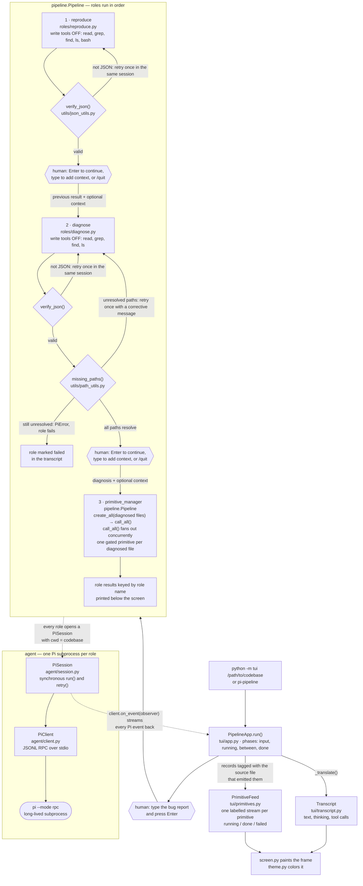
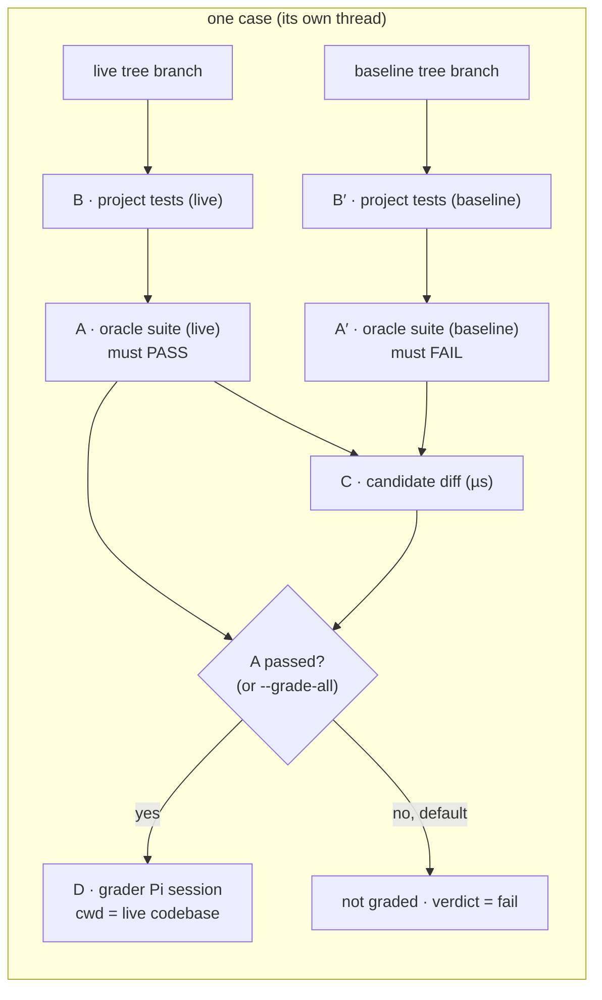

# hms

A simple terminal interface for interacting with the [Pi](https://github.com/earendil-works/pi) coding agent.

## What it does

`python -m agent` launches Pi in RPC mode and wraps it in a small REPL that:

- streams the assistant's response and tool activity to your terminal,
- lets you **insert custom prompts** (a saved-prompt library with `/prompt`),
- lets you **select tools** with an interactive menu (`/tools menu`) or inline (`/tools read,bash,edit,write`),
- gives quick controls for the model, reasoning level, session, and more.

## Usage

```sh
python -m agent                      # start with default tools
python -m agent --select-tools       # pick tools in a menu first
python -m agent -t read,bash,grep    # explicit tool allowlist
python -m agent -m claude            # start on a specific model
python -m agent --thinking low
python -m agent --cwd /path/to/project
```

Sessions persist automatically under `.sessions/` in the working directory.

## Controls

| Command | Action |
|---|---|
| `/tools [menu\|<csv>\|default\|off]` | Select tools (interactive menu, or explicit list) |
| `/models` | List available models |
| `/model <pattern>` | Switch model by id/name substring |
| `/thinking <level>` | Set reasoning level |
| `/state` | Show session state |
| `/new` | Start a fresh session |
| `/abort` | Stop the running operation (or Ctrl+C) |
| `/prompts` | List saved custom prompts |
| `/prompt add <name>` | Save a new custom prompt (multi-line, end with `.`) |
| `/prompt <name>` | Insert a saved prompt into the input line |
| `/prompt show <name>` | Print a saved prompt |
| `/prompt del <name>` | Delete a saved prompt |
| `/cwd` | Show the working directory |
| `/clear` | Clear the screen |
| `/help` | Show help |
| `/quit` | Exit |

Custom prompts are plain Markdown files stored in `agent/prompts/`, so you can
edit them outside the interface too.

## Gated client (optional)

`agent/gated_client.py` adds a second client type — `PiClient` is untouched — for
runs where a tool call must be approved *before* it executes.  It spawns the
same `pi --mode rpc` subprocess with one addition: `--extension agent/tool_gate.js`.
That extension intercepts Pi's `tool_call` event (the only pre-execution hook
Pi offers) and asks the Python side for a verdict over Pi's extension-UI
subprotocol, so the tool never runs until the policy answers:

```
pi  -> hms  {"type":"extension_ui_request","method":"input",
             "title":"hms-tool-gate","placeholder":"<request JSON>"}
hms -> pi   {"type":"extension_ui_response","id":"<same id>","value":"<verdict JSON>"}
```

A policy is any callable from request to verdict:

```python
from agent.gated_client import GatedPiSession

def policy(request):
    # request: {"v", "toolName", "toolCallId", "parentToolCallId"?,
    #          "cwd", "input"}  — nested codemode calls carry parentToolCallId
    if request["toolName"] == "write" and "/etc/" in request["input"]["path"]:
        return {"action": "block", "reason": "system path"}
    return {"action": "allow"}
    # or {"action": "allow", "patch": {"command": "ls /repo"}}  to rewrite args

with GatedPiSession(policy=policy, tools=["read", "bash", "edit", "write"]) as session:
    text = session.run("fix the failing test")
```

The decision is made off the reader thread, so parallel tool calls do not
serialize behind the policy.  It fails closed throughout: an exception, a
non-object verdict, an unknown action, an undecodable request, a missing answer
(`gate_timeout_ms`, default 30 s), or a subprocess that died mid-decision all
block the call and hand the model the reason.  Patches are assigned onto the
tool arguments without re-validation, so a `patch` must be schema-valid.

Keep the policy fast — it runs for every call, before every tool, including the
nested calls a `codemode` script makes.  A policy decides about *tools*; it
does not confine the shell, so a `bash` call can still change a file the policy
would have refused.  Containment beyond the policy is the operating system's job.

## Layout

```
agent/
├── __main__.py     # CLI entry point (python -m agent)
├── interface.py    # interactive REPL and command controls
├── client.py       # JSONL RPC client for the Pi subprocess
├── session.py      # PiSession: owns its PiClient, synchronous request/response
├── gated_client.py # GatedPiClient/GatedPiSession: policy-gated tool calls (optional)
├── tool_gate.js    # Pi extension the gated client loads (jiti, no build step)
├── prompts.py      # custom prompt library + load_prompt()
├── tools.py        # built-in tool catalog and selection
└── prompts/        # your saved prompts (.md files)

roles/
├── diagnose.py     # diagnose an error trace into JSON findings + fixes (write tools disabled)
├── primitive.py    # modify one code unit toward an objective (all tools)
├── primitive_manager.py # PrimitiveManager: registry of primitives keyed by source_file, plus create_all()/call_all() (drives no model of its own, so it has no prompt)
├── reproduce.py    # reproduce a bug and confirm the error exists (write tools disabled)
└── prompts/
    ├── diagnose.md # the diagnose prompt template
    ├── primitive.md # the primitive prompt template
    └── reproduce.md # the reproduce prompt template


utils/
├── json_utils.py   # verify_json(): check model output is valid JSON
└── path_utils.py   # path_resolves()/missing_paths(): check file paths exist

tui/
├── __main__.py     # CLI entry point (python -m tui / pi-pipeline)
├── app.py          # PipelineApp: drives the pipeline in a live terminal UI
├── primitives.py   # PrimitiveFeed: one labelled stream per fanned-out primitive
├── replay.py       # ReplayApp: the same view, fed from a saved transcript
├── screen.py       # raw mode, frame painting, and key parsing
├── theme.py        # OKHSL -> ANSI truecolor, matching Pi's dark/light themes
└── transcript.py   # ordered, bounded stream of role activity

evaluator/
├── __init__.py     # public API: discover_cases(), evaluate(), Case, Grade, Report
├── case.py         # Case + discover_cases(): pair codebase/<n> with solution/<n>
├── runner.py       # run_oracle()/run_project_tests(): subprocess suites, parsed
├── diffing.py      # candidate_diff(): the live tree against the baseline
├── grader.py       # grade_case(): the Pi grading session + rubric normalization
├── report.py       # CaseResult/Report: table, JSON, per-case artifacts
├── engine.py       # evaluate_case()/evaluate_cases(): phase order + fan-out
├── prompts/
│   └── grade.md    # the grader prompt template (rubric + output contract)
└── __main__.py     # CLI entry point (python -m evaluator / pi-evaluate)

benchmarks/
├── dataset.py      # load SWE-bench rows (HF dataset viewer or local JSON/JSONL)
├── repo.py         # base-commit tarball checkout, patch capture, apply check
├── policy.py       # repository-scoped tool gate (paths, shell, unknown tools)
├── runner.py       # pipeline/agent runs, transcripts, predictions, harness call
├── replay.py       # select and replay a saved transcript in the TUI
├── cli.py          # CLI entry point (python -m benchmarks / pi-swebench)
├── prompts/
│   └── swebench.md # the plain-agent patch prompt
├── README.md       # setup, usage, replay, outputs, and limits
└── RESULTS.md      # smoke test and Lite-pass outcomes
```

Requires the `pi` executable on `PATH` and Python 3.14+.

## Roles

Roles are single-purpose, model-driven tasks built on the agent package:

```sh
pi-diagnose "$trace"
pi-diagnose --model claude --cwd /path/to/project < traceback.txt
```

`diagnose` runs Pi with write-capable tools disabled, loads its prompt from
`roles/prompts/diagnose.md`, and asks the model to inspect the working tree
and return a JSON object listing the files responsible for the error together
with possible fixes for each.  If the response is not valid JSON, or if any
reported file path does not resolve to an existing file in the working
directory, it retries once in the same session before giving up.

```sh
pi-reproduce "the login button does nothing"
pi-reproduce --model claude --cwd /path/to/project < bug_report.txt
```

`reproduce` runs Pi with write-capable tools (`write`, `edit`) disabled — the
model inspects the working tree and runs existing code through `bash` to
demonstrate the error, without changing anything — loads its prompt from
`roles/prompts/reproduce.md`, and asks the model to reproduce the reported bug
and confirm the error exists.  Its only job is the reproduction: the agent must
not fix the bug or write regression tests, and it reports the observed evidence
plus the context (relevant files, reproduction steps, notes) that the
downstream `diagnose` role needs.  If the response is not valid JSON, it retries
once in the same session before giving up.

```sh
pi-primitive "fix the crash on startup" --file src/app.py --cwd /path/to/project
pi-primitive --file src/app.py --dep src/db.py="reads settings from here" < objective.txt
```

`primitive` is the first role that changes the codebase, so it runs Pi with
*every* tool available — the read, search, and list tools to reason about the
system, `write` and `edit` to apply the change, and `bash` to run what it
changed.  It is also the first role to run on the [gated client](#gated-client-optional),
which makes the prompt's "modify only your own artifact" rule enforced rather
than advisory: `writes_only_to(source_file)` builds the policy, so a `write` or
`edit` aimed anywhere else is blocked before it executes with the reason
"primitive gate: this primitive may only write …".  Every other tool, `bash`
included, still runs without a decision — the gate fences the write tools, not
the shell, so a command the model runs can still change another file and the
assistant's report may claim an edit that was actually blocked.  Verify the
tree (`git diff`) before trusting the report, and confine the shell itself
with an operating-system boundary when that is required.  It loads its prompt from `roles/prompts/primitive.md`, which asks the
model to reason about the objective within the primitive's dependency context
and to modify only the portions of its own artifact that the objective
requires.  The unit of work is a `Primitive` (defined in
`roles/primitive.py`): the `source_file` it owns plus the `dep_files` mapping
that records the relationships bounding it.  A `Primitive` keeps one Pi session
attached and reuses it across objectives, so a second modification on the same
unit does not spawn a new subprocess; `roles.primitive_manager.PrimitiveManager`
holds the registry of primitives keyed by source file.  It registers work with
`create_primitive(source_file)` (one path at a time) or `create_all(paths)` (a
whole list), and runs it with `call_primitive(source_file)` or `call_all()`:
`call_all` is `call_primitive` applied to the registry, so a path with no
primitive registered simply produces no report.  It runs the registry in
parallel, one worker per primitive (`max_workers` caps that, `1` runs them in
registration order), collects each report as it comes back, and closes every
session before it returns — joined first, so no agent is torn down while it is
still running.  A path whose primitive fails does not take its siblings' reports
with it, but it fails the call with `PrimitiveRunError`, which carries the
reports that did come back beside the failures that did not.  Closing is
resilient the same way: one session that refuses to close cannot strand the
sessions behind it — every primitive is attended to, and the paths that could
not be closed are reported afterwards with `PrimitiveCloseError`.  A session
also fails fast when its Pi dies mid-turn, instead of waiting out its timeout
on a turn that can never settle.  `PrimitiveManager`
drives no model of its own, which is why it has no prompt.  The role returns the
assistant's report: the modification applied, or the explicit statement that no
local change was necessary.

The pipeline runs these roles in order — `reproduce` answers whether the bug is
real, `diagnose` names the files responsible for it, and
`pipeline._run_primitive_manager` turns that diagnosis into the registry's
input: it registers a primitive per diagnosed file with `create_all`, fans them
all out with `call_all`, closes the registry afterwards, and keys each
primitive's objective to the finding that named its file.

## Interactive pipeline (TUI)

The `tui` package wraps :class:`pipeline.Pipeline` in a full-screen terminal
UI that streams each role's activity live — assistant text, tool calls, role
banners, and a status bar — in a color palette faithful to Pi's `dark` (and
`light`) themes.  The only interaction points are where a human must type:

```sh
python -m tui /path/to/codebase
python -m tui /path/to/codebase --model claude --thinking low --theme dark
pi-pipeline /path/to/codebase --theme light
```

You are prompted for the bug report first.  The `reproduce` role then runs
while you watch it stream, and the following roles start automatically as each
one finishes.  Once the pipeline finishes, the collected role results are
printed below the screen.

### Flow



The TUI never talks to a role directly: it installs itself as the pipeline's
`observer` and translates whatever each role's Pi subprocess emits into
transcript lines, so the screen is a live view of work the roles are already
doing.  The primitives of a fan-out all stream through that one observer, so
the pipeline tags each record with the source file that emitted it and
publishes the fan-out itself — [the app routes those records to
`tui/primitives.py`](#watching-the-fanned-out-primitives), which keeps one
stream per primitive and the state each one is in.

| Key | Action |
|---|---|
| type + Enter | enter the bug report / optional context |
| Enter | continue to the next role |
| `/quit` | exit at any input prompt |
| `↑`/`↓`, `PgUp`/`PgDn` | scroll the transcript |
| `Home` / `End` | jump to the top / back to the latest output |
| `Ctrl+U` | clear the input line |
| `Ctrl+C` | during a role: quit after the current role finishes |
| `Tab` | move along the primitives of a fan-out |
| `Enter` | open the highlighted primitive and watch only its stream |
| `Esc` / `q` / `Backspace` | leave one primitive and see the whole fan-out again |

Controls available while a role is running are minimal by design — the TUI is
a watchable view of the pipeline, not a second interactive agent session.

### Watching the fanned-out primitives

`primitive_manager` is the role that fans out: `call_all()` runs every
registered primitive at once, one gated Pi session per diagnosed file, so
left alone every agent's stream would interleave into one unreadable river.
The pipeline keeps them apart: it stamps each record a primitive streams with
the source file that emitted it (the `primitive` key on the record), and it
publishes the fan-out itself as it goes — the files it spans, the report each
primitive came back with, and the failure each one raised.  The TUI turns that
into a panel beside the transcript:

```
╭──────────────────────────────────────────────────────────────────────────────╮
│ hms pipeline · claude · low · role 3/3                                        │
├──────────────────────────┬────────────────────────────────────────────────────┤
│ primitives (3)           │ ⟳ src/parser.py                          0.0s      │
│ ▸ environment/…/parser.py│   parser.py ⚙ read src/parser.py … ✓ (12 ms)       │
│   environment/…/db.py    │   parser.py ⚙ edit src/parser.py …                │
│   environment/…/toolbar  │ ✓ src/db.py                              0.0s     │
│                          │   db.py closing the cursor …                      │
│                          │ ✗ environment/…/toolbar.py               failed    │
│                          │   toolbar.py ✗ pi exited before the turn settled  │
├──────────────────────────┴────────────────────────────────────────────────────┤
│ Tab switch · Enter open a primitive                                           │
│ ⠹  running primitive_manager · 0.0s  · 3 primitives · 1 running · 1 error      │
╰──────────────────────────────────────────────────────────────────────────────╯
```

Every primitive of the fan-out is listed in the panel with its marker and file
name, and its stream is streamed in the body under a header of its own, each
line labelled with the file it came from.  A file name is painted in the
theme's error color the moment its agent fails — before any of its output is
read — and in the success color once it has reported.  `Tab` moves along the
list, `Enter` opens the highlighted primitive so the body shows only that
agent, `↑`/`↓` scrolls it, and `Esc`/`q`/`Backspace` return to the whole
fan-out.  The panel is dropped in a terminal narrower than 64 columns, where
the streams stay labelled inline instead.

## Evaluator (final fix validator)

`evaluator/` judges a finished run and nothing else: it imports only the
public `agent` and `utils` surfaces — no `pipeline`, `roles`, or `tui` — so
it can evaluate a run long after it finished, from another process, or
against a copy.

```sh
pi-evaluate                                  # .environment/ (or environment/)
pi-evaluate --environment ./environment --codebase 2 --codebase 5
pi-evaluate --no-grade                       # tests only, no model calls
pi-evaluate --grade-all --json report.json --report-dir artifacts/
```

An **environment root** holds `codebase/<n>/` (the projects) and
`solution/<n>/` (each project's oracle suite plus its reference diff).  The
default root is the gitignored `.environment/` where pipeline runs land; the
pristine `environment/` is the **baseline**, which the run auto-pairs with
its live sibling.  `--baseline`/`--no-baseline` override that.

Each case runs four phases in order — the codebase's **own** tests (B), the
**oracle** suite (A), the **candidate diff** against the baseline (C), and
the **grader** (D) — while the baseline tree's verification runs beside the
live branch:



The oracle gates grading: a fix that does not pass its oracle is never
graded unless `--grade-all` asks for the diagnostic grade (correctness then
counts zero).  A′ is the **negative control** — an oracle suite that passes on
the buggy baseline detects nothing, and the case fails on a broken
environment instead of a grade.  The grader (read-only tools plus `bash`,
one Pi session with `cwd` at the codebase) receives the issue, the reference
diff, the candidate diff, and every test result, and returns a weighted JSON
verdict: correctness 40, equivalence to the reference 25, minimality 20,
quality 15 — `pass` at 85+, `partial` at 60–84, `fail` below.  It re-reads
the working tree itself, which is what catches what the oracle cannot: scope
creep into unrequested files, dead defensive code, untested divergences from
the reference.

Cases are independent and grading dominates the wall clock, so
`evaluate_cases` fans the cases out over a thread pool — one worker per case
by default (`--jobs` caps it; `--jobs 1` is sequential).  A failing grader
never takes its siblings down: it becomes that case's `error` outcome.  The
console table stays deterministic; `--report-dir` writes per-case artifacts
(`oracle.txt`, `own-tests.txt`, `candidate.diff`, `grade.json`,
`result.json`).

Exit codes: `0` every case passed, `1` the run finished but something failed,
`2` a setup problem (no environment, no cases, bad arguments).

## SWE-bench

`benchmarks/` runs hms against [SWE-bench](https://github.com/swe-bench/SWE-bench)
tasks and writes the patch predictions the official harness grades.  For each
task it downloads the base commit's GitHub tarball, commits it as a local
baseline, runs either the role chain (`--mode pipeline`) or one patch-oriented
Pi session (`--mode agent`), captures the tree diff, checks that it applies,
and records one `model_patch` row:

```sh
python -m benchmarks.swebench --instance-id pallets__flask-4045 --dry-run
python -m benchmarks.swebench --instance-id pallets__flask-4045 --skip-reproduce

# Grade with the official harness (installed separately, in its own venv)
python -m benchmarks.swebench --instance-id pallets__flask-4045 --skip-reproduce \
    --evaluate --swebench-bin .swebench/swebench-venv/bin/swebench
```

The defaults are `SWE-bench/SWE-bench_Lite`, `opencode-go/cat-jam-free`, and
`max` reasoning.  Host checkouts do not install a project's dependencies, so
`--skip-reproduce` is recommended (diagnose works from the issue and source);
the official harness runs the project's tests in its own image.  A saved
transcript can be watched with `pi-swebench replay <run-dir>`; see
[benchmarks/README.md](benchmarks/README.md) for the harness setup, replay
keys, output layout, and the containerized-agent limitation.
