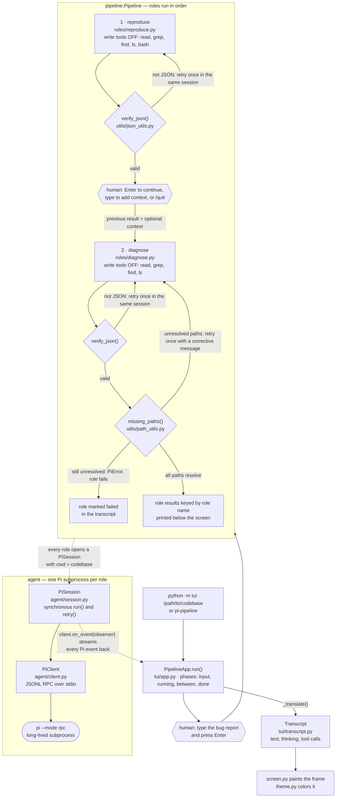

# hms

A simple terminal interface for interacting with the [Pi](https://github.com/earendil-works/pi) coding agent.

## What it does

`python -m agent` launches Pi in RPC mode and wraps it in a small REPL that:

- streams the assistant's response and tool activity to your terminal,
- lets you **insert custom prompts** (a saved-prompt library with `/prompt`),
- lets you **select tools** with an interactive menu (`/tools menu`) or inline (`/tools read,bash,edit,write`),
- gives quick controls for the model, reasoning level, session, and more.

## Usage

```sh
python -m agent                      # start with default tools
python -m agent --select-tools       # pick tools in a menu first
python -m agent -t read,bash,grep    # explicit tool allowlist
python -m agent -m claude            # start on a specific model
python -m agent --thinking low
python -m agent --cwd /path/to/project
```

Sessions persist automatically under `.sessions/` in the working directory.

## Controls

| Command | Action |
|---|---|
| `/tools [menu\|<csv>\|default\|off]` | Select tools (interactive menu, or explicit list) |
| `/models` | List available models |
| `/model <pattern>` | Switch model by id/name substring |
| `/thinking <level>` | Set reasoning level |
| `/state` | Show session state |
| `/new` | Start a fresh session |
| `/abort` | Stop the running operation (or Ctrl+C) |
| `/prompts` | List saved custom prompts |
| `/prompt add <name>` | Save a new custom prompt (multi-line, end with `.`) |
| `/prompt <name>` | Insert a saved prompt into the input line |
| `/prompt show <name>` | Print a saved prompt |
| `/prompt del <name>` | Delete a saved prompt |
| `/cwd` | Show the working directory |
| `/clear` | Clear the screen |
| `/help` | Show help |
| `/quit` | Exit |

Custom prompts are plain Markdown files stored in `agent/prompts/`, so you can
edit them outside the interface too.

## Gated client (optional)

`agent/gated_client.py` adds a second client type — `PiClient` is untouched — for
runs where a tool call must be approved *before* it executes.  It spawns the
same `pi --mode rpc` subprocess with one addition: `--extension agent/tool_gate.js`.
That extension intercepts Pi's `tool_call` event (the only pre-execution hook
Pi offers) and asks the Python side for a verdict over Pi's extension-UI
subprotocol, so the tool never runs until the policy answers:

```
pi  -> hms  {"type":"extension_ui_request","method":"input",
             "title":"hms-tool-gate","placeholder":"<request JSON>"}
hms -> pi   {"type":"extension_ui_response","id":"<same id>","value":"<verdict JSON>"}
```

A policy is any callable from request to verdict:

```python
from agent.gated_client import GatedPiSession

def policy(request):
    # request: {"v", "toolName", "toolCallId", "parentToolCallId"?,
    #          "cwd", "input"}  — nested codemode calls carry parentToolCallId
    if request["toolName"] == "write" and "/etc/" in request["input"]["path"]:
        return {"action": "block", "reason": "system path"}
    return {"action": "allow"}
    # or {"action": "allow", "patch": {"command": "ls /repo"}}  to rewrite args

with GatedPiSession(policy=policy, tools=["read", "bash", "edit", "write"]) as session:
    text = session.run("fix the failing test")
```

The decision is made off the reader thread, so parallel tool calls do not
serialize behind the policy.  It fails closed throughout: an exception, a
non-object verdict, an unknown action, an undecodable request, a missing answer
(`gate_timeout_ms`, default 30 s), or a subprocess that died mid-decision all
block the call and hand the model the reason.  Patches are assigned onto the
tool arguments without re-validation, so a `patch` must be schema-valid.

Keep the policy fast — it runs for every call, before every tool, including the
nested calls a `codemode` script makes.  A policy decides about *tools*; it
does not confine the shell, so a `bash` call can still change a file the policy
would have refused.  Containment beyond the policy is the operating system's job.

## Layout

```
agent/
├── __main__.py     # CLI entry point (python -m agent)
├── interface.py    # interactive REPL and command controls
├── client.py       # JSONL RPC client for the Pi subprocess
├── session.py      # PiSession: owns its PiClient, synchronous request/response
├── gated_client.py # GatedPiClient/GatedPiSession: policy-gated tool calls (optional)
├── tool_gate.js    # Pi extension the gated client loads (jiti, no build step)
├── prompts.py      # custom prompt library + load_prompt()
├── tools.py        # built-in tool catalog and selection
└── prompts/        # your saved prompts (.md files)

roles/
├── diagnose.py     # diagnose an error trace into JSON findings + fixes (write tools disabled)
├── primitive.py    # modify one code unit toward an objective (all tools)
├── primitive_manager.py # PrimitiveManager: registry of primitives keyed by source_file (drives no model, so it has no prompt)
├── reproduce.py    # reproduce a bug and confirm the error exists (write tools disabled)
└── prompts/
    ├── diagnose.md # the diagnose prompt template
    ├── primitive.md # the primitive prompt template
    └── reproduce.md # the reproduce prompt template

primitives/
├── __init__.py     # re-exports Primitive (from roles.primitive) and the manager
└── manager.py      # PrimitiveManager: registry of primitives keyed by source_file

utils/
├── json_utils.py   # verify_json(): check model output is valid JSON
└── path_utils.py   # path_resolves()/missing_paths(): check file paths exist

tui/
├── __main__.py     # CLI entry point (python -m tui / pi-pipeline)
├── app.py          # PipelineApp: drives the pipeline in a live terminal UI
├── screen.py       # raw mode, frame painting, and key parsing
├── theme.py        # OKHSL -> ANSI truecolor, matching Pi's dark/light themes
└── transcript.py   # ordered, bounded stream of role activity
```

Requires the `pi` executable on `PATH` and Python 3.9+.

## Roles

Roles are single-purpose, model-driven tasks built on the agent package:

```sh
pi-diagnose "$trace"
pi-diagnose --model claude --cwd /path/to/project < traceback.txt
```

`diagnose` runs Pi with write-capable tools disabled, loads its prompt from
`roles/prompts/diagnose.md`, and asks the model to inspect the working tree
and return a JSON object listing the files responsible for the error together
with possible fixes for each.  If the response is not valid JSON, or if any
reported file path does not resolve to an existing file in the working
directory, it retries once in the same session before giving up.

```sh
pi-reproduce "the login button does nothing"
pi-reproduce --model claude --cwd /path/to/project < bug_report.txt
```

`reproduce` runs Pi with write-capable tools (`write`, `edit`) disabled — the
model inspects the working tree and runs existing code through `bash` to
demonstrate the error, without changing anything — loads its prompt from
`roles/prompts/reproduce.md`, and asks the model to reproduce the reported bug
and confirm the error exists.  Its only job is the reproduction: the agent must
not fix the bug or write regression tests, and it reports the observed evidence
plus the context (relevant files, reproduction steps, notes) that the
downstream `diagnose` role needs.  If the response is not valid JSON, it retries
once in the same session before giving up.

```sh
pi-primitive "fix the crash on startup" --file src/app.py --cwd /path/to/project
pi-primitive --file src/app.py --dep src/db.py="reads settings from here" < objective.txt
```

`primitive` is the first role that changes the codebase, so it runs Pi with
*every* tool available — the read, search, and list tools to reason about the
system, `write` and `edit` to apply the change, and `bash` to run what it
changed.  It is also the first role to run on the [gated client](#gated-client-optional),
which makes the prompt's "modify only your own artifact" rule enforced rather
than advisory: `writes_only_to(source_file)` builds the policy, so a `write` or
`edit` aimed anywhere else is blocked before it executes with the reason
"primitive gate: this primitive may only write …".  Every other tool, `bash`
included, still runs without a decision — the gate fences the write tools, not
the shell, so a command the model runs can still change another file and the
assistant's report may claim an edit that was actually blocked.  Verify the
tree (`git diff`) before trusting the report, and confine the shell itself
with an operating-system boundary when that is required.  It loads its prompt from `roles/prompts/primitive.md`, which asks the
model to reason about the objective within the primitive's dependency context
and to modify only the portions of its own artifact that the objective
requires.  The unit of work is a `Primitive` (defined in
`roles/primitive.py`): the `source_file` it owns plus the `dep_files` mapping
that records the relationships bounding it.  A `Primitive` keeps one Pi session
attached and reuses it across objectives, so a second modification on the same
unit does not spawn a new subprocess; `primitives.PrimitiveManager` holds the
registry of primitives keyed by source file.  The role returns the assistant's
report: the modification applied, or the explicit statement that no local
change was necessary.

## Interactive pipeline (TUI)

The `tui` package wraps :class:`pipeline.Pipeline` in a full-screen terminal
UI that streams each role's activity live — assistant text, tool calls, role
banners, and a status bar — in a color palette faithful to Pi's `dark` (and
`light`) themes.  The only interaction points are where a human must type:

```sh
python -m tui /path/to/codebase
python -m tui /path/to/codebase --model claude --thinking low --theme dark
pi-pipeline /path/to/codebase --theme light
```

You are prompted for the bug report first.  The `reproduce` role then runs
while you watch it stream, and before `diagnose` starts you can press Enter to
continue, type a message to add as operator context, or `/quit`.  Once the
pipeline finishes, the collected role results are printed below the screen.

### Flow



The TUI never talks to a role directly: it installs itself as the pipeline's
`observer` and translates whatever each role's Pi subprocess emits into
transcript lines, so the screen is a live view of work the roles are already
doing.

| Key | Action |
|---|---|
| type + Enter | enter the bug report / optional context |
| Enter | continue to the next role |
| `/quit` | exit at any input prompt |
| `↑`/`↓`, `PgUp`/`PgDn` | scroll the transcript |
| `Home` / `End` | jump to the top / back to the latest output |
| `Ctrl+U` | clear the input line |
| `Ctrl+C` | during a role: quit after the current role finishes |

Controls available while a role is running are minimal by design — the TUI is
a watchable view of the pipeline, not a second interactive agent session.
